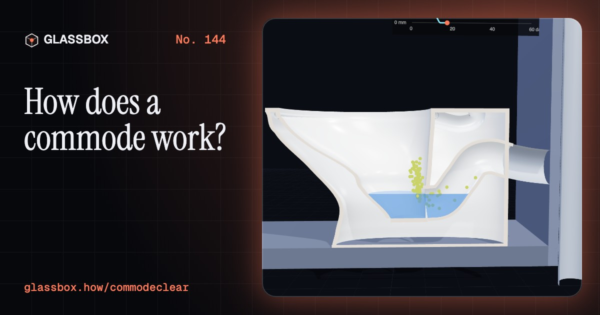
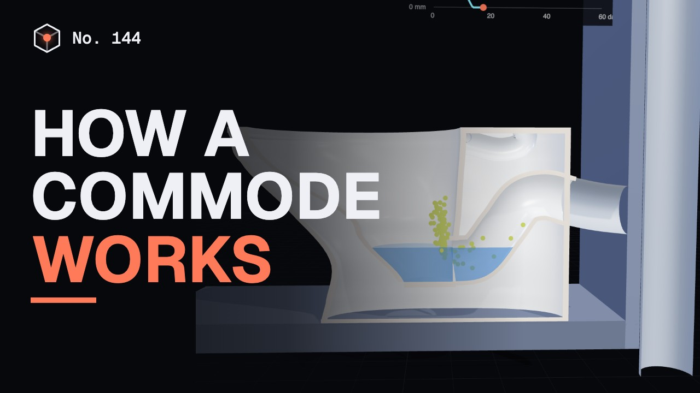
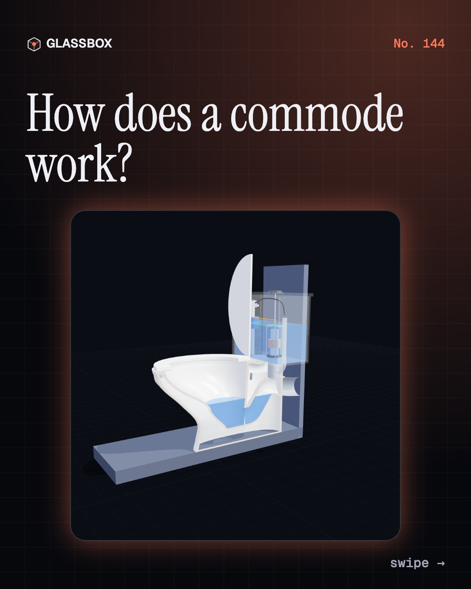
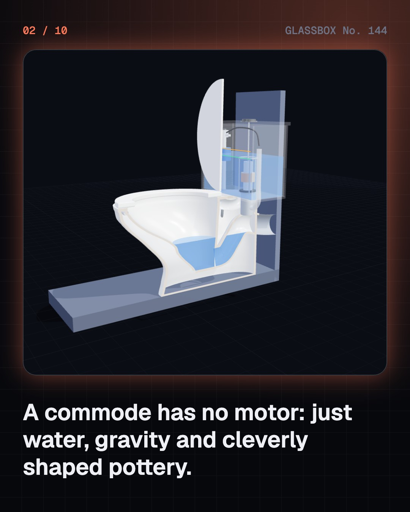
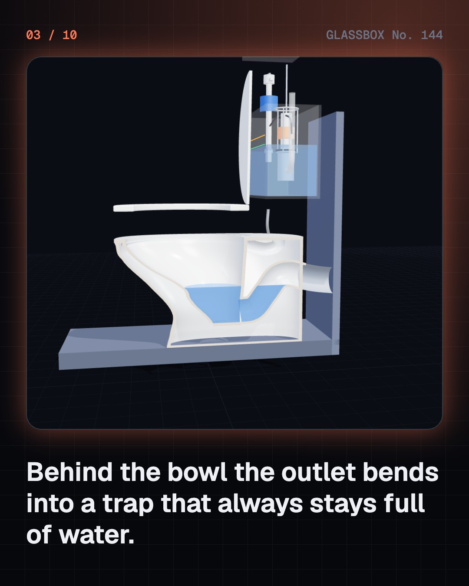
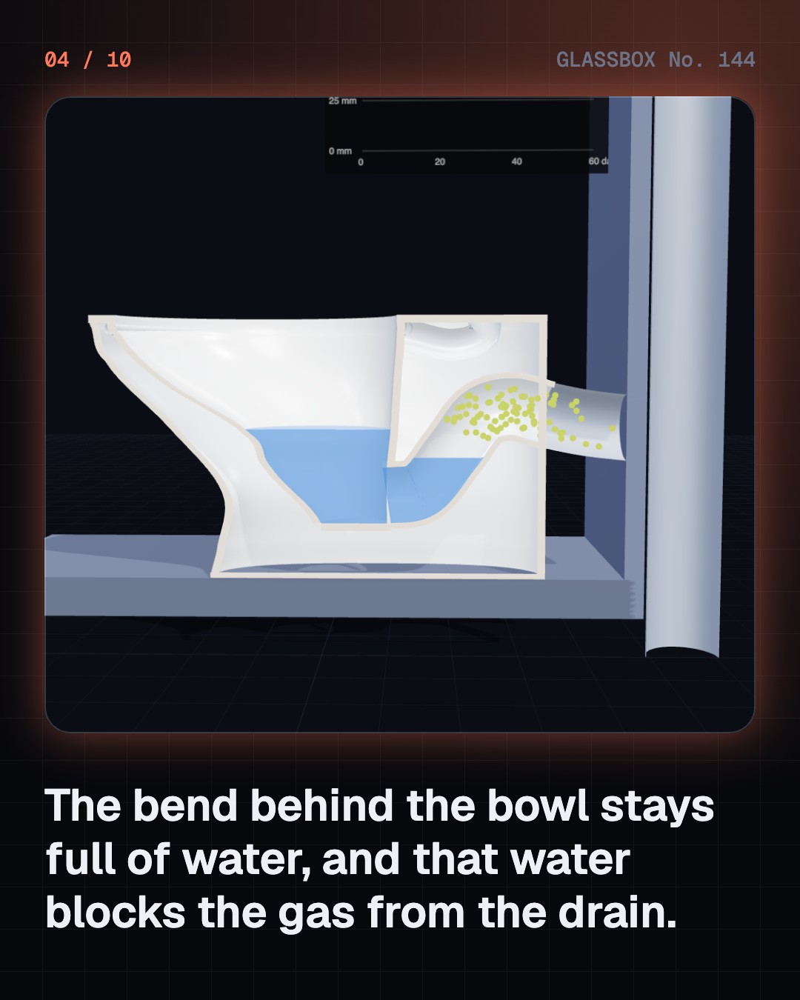

<!-- glassbox:start -->
<!-- Generated from glassbox.json by the Glassbox hub (npm run readme -- commodeclear). Edit glassbox.json, not this block. -->
<p align="center"><a href="https://glassbox.how/e/commodeclear/"></a></p>

<h1 align="center">CommodeClear</h1>

<p align="center"><b>How does a commode work?</b><br>No motor, no pump: a bent pipe that stays full of water, and a tank that empties in three seconds. Cut a commode in half in 3D, flush it two ways, and see why a fast bucket works and a slow one never does.</p>

<p align="center"><a href="https://glassbox.how/commodeclear/"><b>▶ Play with it</b></a> &nbsp;·&nbsp; <a href="https://glassbox.how/e/commodeclear/">Read the 60-second explainer</a> &nbsp;·&nbsp; <a href="https://glassbox.how/commodeclear/glassbox/reel.mp4">Watch the 40-second video</a></p>

<p align="center">
  <a href="https://glassbox.how/e/commodeclear/"></a>
  <a href="https://glassbox.how/e/commodeclear/"></a>
  <a href="LICENSE"></a>
  <a href="LICENSE-CONTENT.md"></a>
  <a href="#privacy"></a>
</p>

## In 60 seconds

1. **A bowl, a bend and a tank.** A commode is one piece of glazed ceramic with a bowl on top and a bent passage, the trap, cast in behind it. On the back sits the cistern, a tank holding one flush of water, with a fill valve, a float, a flush valve and an overflow tube inside.
2. **The trap is a plug made of water.** Water always stands in the bend of the trap, level with its lip, the weir. That 50 mm of water blocks the gas from the drain. It is a gentle seal: about 490 pascals of suction pulls it out, and a few weeks without a flush can dry it up.
3. **A flush is a push or a pull.** A wash-down pan, the usual kind in India and Europe, dumps the water in fast and pushes the contents over the weir. A siphonic pan, the usual kind in North America, fills its narrow trapway so the falling water sucks the bowl empty until air breaks the siphon. Either way it has to be fast, which is why a bucket works only when poured quickly.
4. **Two valves and a float.** Pressing the button lifts the flush valve and about six litres leave in three seconds, or three litres on the half flush. The float then falls, opens the fill valve, and rises with the water to shut it at the set line. The overflow tube catches any excess. A worn seal or a float set too high makes the cistern run on.
5. **Indian pan, Western pan, same trap.** A squat pan and a seated commode are the same machine underneath. A pour-flush Indian pan has a steep glazed floor and a shallow seal, so 1.5 to 2 litres from a mug does the job that takes a cistern 3 to 6 litres.
6. **Then it needs somewhere safe to go.** The outlet joins a soil stack whose top is a vent, open above the roof, so that falling water cannot suck the traps dry. At the bottom is a sewer, a septic tank, or the twin leach pits used across rural India, where one pit rests and dries while the other fills.

## Words worth knowing

| Term | Meaning |
|---|---|
| **Trap** | The bend in the outlet passage that always holds water. |
| **Water seal** | The water standing in the trap, at least 50 mm deep in a commode. It keeps drain gas out of the room. |
| **Weir** | The lip at the top of the trap's hump. It sets the water level in the bowl. |
| **Wash-down pan** | A pan with a wide, short trapway that is cleared by the push of the flush water. |
| **Siphonic pan** | A pan whose narrow trapway fills with water so that a siphon pulls the bowl empty. |
| **Cistern** | The tank that stores the water for one flush and releases it quickly. |
| **Fill valve and float** | The valve that refills the cistern, shut by a float when the water reaches the set level. |
| **Pour-flush** | Flushing a pan by tipping in 1.5 to 2 litres from a mug or bucket, with no cistern. |
| **Vent pipe** | The open top of the soil stack above the roof. It lets air in so falling water cannot pull the seals out of traps. |

## A short history

**4,500 years from brick drains in the Indus cities to seats that wash, and the unfinished work of a safe toilet for everyone.**

- **2500 BCE** · Toilets and brick drains in the Indus cities (Indus Valley builders, Mohenjo-daro and Lothal (today Pakistan and India))
- **1596** · Harington's water closet (Sir John Harington, Kelston, Somerset, England)
- **1775** · The S-bend (Alexander Cumming, London, England)
- **1851** · Spending a penny at the Great Exhibition (George Jennings, The Crystal Palace, Hyde Park, London, England)
- **1858** · The Great Stink and London's sewers (Joseph Bazalgette, London, England)
- **1884** · One piece of pottery (Thomas William Twyford, Hanley, Stoke-on-Trent, England)
- **1970** · Sulabh and the twin-pit toilet (Bindeshwar Pathak, Bihar, India)
- **1980** · Two buttons, two flushes (Caroma, Australia)

The full story, with 30 moments, charts, people and 47 sources: [glassbox.how/e/commodeclear/history](https://glassbox.how/e/commodeclear/history/). The data lives in [`history.json`](history.json).

## Video and slides

Made with the Glassbox studio from this box's storyboard (`window.glassbox.director`). Free to reuse under CC BY 4.0.

<a href="https://glassbox.how/commodeclear/glassbox/video.mp4"></a>

<p><a href="glassbox/slide-1.jpg"></a> <a href="glassbox/slide-2.jpg"></a> <a href="glassbox/slide-3.jpg"></a> <a href="glassbox/slide-4.jpg"></a></p>

| File | What | Size |
|---|---|---|
| [`glassbox/reel.mp4`](https://glassbox.how/commodeclear/glassbox/reel.mp4) | Reel / Short, with captions and soundtrack | 1080×1920 |
| [`glassbox/video.mp4`](https://glassbox.how/commodeclear/glassbox/video.mp4) | YouTube video, with captions and soundtrack | 1920×1080 |
| `glassbox/slide-1…10.jpg` | Instagram carousel | 1080×1350 |
| `glassbox/thumb.jpg` | YouTube thumbnail | 1280×720 |
| `glassbox/cover.jpg` | Share card and repo social preview | 1200×630 |
| [`glassbox/history-reel.mp4`](https://glassbox.how/commodeclear/glassbox/history-reel.mp4) | “History in 10 moments” Reel / Short | 1080×1920 |
| `glassbox/history-slide-*.jpg` | History carousel | 1080×1350 |
| `glassbox/post.json` | Post copy and schedule used by the publish kit | |

## Privacy

This box has no accounts and no ads, and it ships its own fonts and libraries. When you run it yourself it sends nothing anywhere. On glassbox.how, the site's `/bar.js` also loads Glassbox's analytics: **Google Analytics** to count visits (it asks first in the EU, UK and Switzerland, and stays off when your browser sends Global Privacy Control or Do Not Track) and **ClickTrust** to detect bots.

It remembers a few things **in your own browser only**, and never sends them anywhere:

| Browser storage key | What it holds |
|---|---|
| `commodeclear.v1` | Which chapters you have opened, your best quiz scores, and sound on or off. |

Exactly what each one sees is at [glassbox.how/privacy](https://glassbox.how/privacy/).

## Licences

- **Code:** [MIT](LICENSE). Use it, change it, ship it.
- **Explanations, text, images and videos** (`glassbox.json`, `glassbox/`): [CC BY 4.0](LICENSE-CONTENT.md). Credit “Glassbox, glassbox.how/e/commodeclear”.
- **Third-party parts** keep their own licences: [three.js](https://threejs.org) (MIT), [Geist, Instrument Serif](https://openfontlicense.org) (SIL OFL 1.1).
- The Glassbox name and logo aren't covered by either licence. See the [terms](https://glassbox.how/terms/).

Found a mistake? [Open an issue](https://github.com/bdeeps/commodeclear/issues). Corrections happen in public.
<!-- glassbox:end -->

## Run it

It's plain HTML, CSS and JavaScript. No build step and no dependencies. Run locally, it contacts no other website.

```bash
python3 -m http.server 8000
```

Three.js and the fonts ship in `vendor/` and `fonts/`, so it also works offline.

Then open http://localhost:8000.

## How it's built

| File | What |
|---|---|
| `index.html`, `css/app.css` | The page and its styles |
| `js/app.js`, `js/stage.js`, `js/ui.js`, `js/kit.js` | The shared Glassbox 3D engine: chapters, 3D stage, controls, quiz, video director |
| `js/chapters/*.js` | One file per chapter: the 3D model, controls, text, key terms, quiz and video scenes |
| `js/commode.js` | CommodeClear's shared models and physics: the pan cut in half, the cistern, and the flush, trap and cistern simulations |
| `glassbox.json` | Title, question, explainer beats, key terms, browser storage and credits shown on glassbox.how |
| `reel` in each chapter | The storyboard the Glassbox studio records into short videos |
| `glassbox/` | The published video, slides, thumbnail and post copy |
| `fonts/`, `vendor/three/` | Self-hosted Geist and Instrument Serif (SIL OFL 1.1) and three.js (MIT) |
